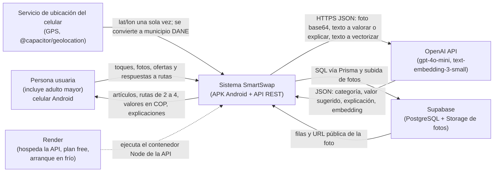

# 1. Vista de contexto

SmartSwap AI es una plataforma de trueque circular para Nariño, Colombia. En lugar de exigir que dos personas quieran exactamente lo que la otra ofrece, el sistema busca ciclos de intercambio de 2 a 4 personas (A le da a B, B a C, C a A) y equilibra la diferencia de valor en pesos colombianos (COP). La persona usuaria, incluidas personas adultas mayores, usa una app Android; la inteligencia artificial reconoce el objeto en la foto, sugiere su valor y explica en lenguaje sencillo por qué una ruta de trueque es justa. Esta vista muestra SmartSwap como una sola caja y los sistemas externos de los que depende.

Nota: entre la APK y la API todo viaja por HTTPS JSON en `/api/v1` (las fotos suben en base64 a `POST /api/v1/items/upload-image`). Las coordenadas GPS nunca se guardan: solo el código de departamento y municipio DANE.

| Elemento | Responsabilidad | Dónde está en el código |
|---|---|---|
| Persona usuaria | Publica artículos con foto, revisa y acepta rutas de trueque | `mobile/` (interfaz que usa) |
| Sistema SmartSwap: APK | App Android (Capacitor) que llama a la API por HTTPS JSON `/api/v1` | `mobile/` |
| Sistema SmartSwap: API | Lógica de artículos, ciclos de trueque, valoración en COP y geografía | `api/` |
| OpenAI API | Visión y valoración de la foto, explicación de rutas (gpt-4o-mini) y embeddings (text-embedding-3-small) | `api/src/modules/ai/services/openai-client.service.ts` |
| Supabase | Base de datos PostgreSQL y Storage para las fotos de los artículos | `api/src/modules/storage/supabase-storage.service.ts` (Prisma en `api/prisma/`) |
| Render | Hospeda la API (plan free, se duerme y tiene arranque en frío); health check en `/api/v1/health` | `render.yaml` |
| Servicio de ubicación | Entrega el GPS una vez; la API lo resuelve a municipio DANE y descarta las coordenadas | `mobile/src/services/geo/geolocation.ts`, `api/src/modules/geo/` |

**Cómo dibujarlo a mano:** (1) dibuja la caja grande "Sistema SmartSwap" en el centro; (2) pon a la izquierda la Persona usuaria y debajo de ella el Servicio de ubicación del celular; (3) pon a la derecha OpenAI y Supabase, y abajo Render con una flecha punteada hacia SmartSwap; (4) traza las flechas y escribe sobre cada una qué viaja (HTTPS JSON `/api/v1`, foto base64, municipio DANE, SQL, URL de la foto).
