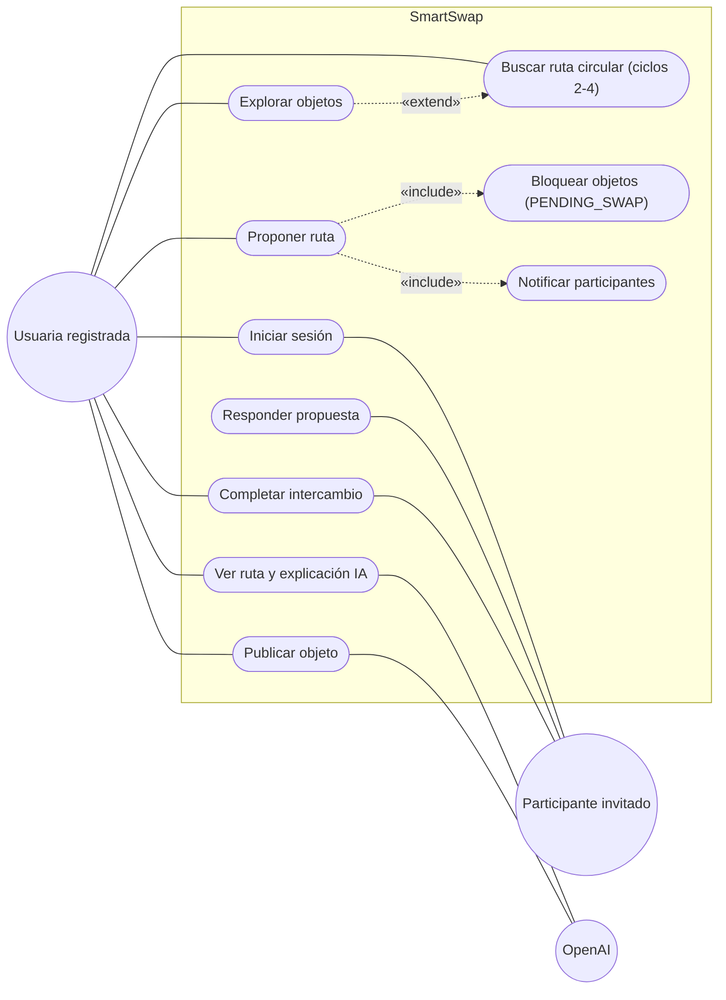

# 2. Vista funcional (casos de uso)

La vista funcional es el "+1" del modelo 4+1: los escenarios que justifican y validan las otras cuatro vistas. SmartSwap tiene dos actores principales, la **Usuaria registrada**, que publica objetos e inicia rutas de trueque circular, y el **Participante invitado**, que recibe una propuesta y la acepta o rechaza. **OpenAI** es un actor secundario que el sistema invoca para analizar fotos, estimar valores en COP y explicar rutas. El diagrama cubre los tres flujos de la demo: F1 (buscar una ruta completa y proponerla), F2 (publicar un objeto) y F3 (explorar el catálogo y proponer).

Notas de lectura:

- Las flechas punteadas `«include»` indican pasos que siempre ocurren al proponer: los objetos de la ruta quedan en `PENDING_SWAP` y se notifica a cada participante.
- `«extend»` desde *Explorar objetos* indica que, al elegir un objeto del catálogo, se entra al flujo de búsqueda de ruta con ese objeto como objetivo ya preseleccionado.
- *Publicar objeto* usa OpenAI dos veces: visión para generar los metadatos a partir de la foto y estimación del valor en COP.

## Flujos de la demo

| Flujo | Pasos en la app (pantallas reales) | Endpoints |
|---|---|---|
| **F1** Login, buscar ruta completa, proponer | `LoginScreen` → `HomeScreen` → `ConfigureSwapScreen` (objeto ofrecido y objetivo) → `SearchingScreen` (el motor busca ciclos de 2 a 4) → `RouteResultsScreen` → `RouteDetailScreen` (explicación IA) → `ProposalConfirmScreen` → `ProposalSentScreen`. El participante ve la propuesta en `NotificationsScreen` / `TradesScreen`, la acepta o rechaza, y al entregar se completa desde `TradesScreen`. | `POST /auth/login`, `POST /routes/search`, `GET /routes/:id`, `POST /ai/explain-route`, `POST /routes/propose` (bloquea los objetos en `PENDING_SWAP` y notifica), `POST /proposals/:id/respond` (`ACCEPTED` / `REJECTED`), `POST /proposals/:id/complete` |
| **F2** Publicar objeto | `HomeScreen` → `PublishScreen`: subir foto, recibir metadatos sugeridos por IA, ver el valor estimado en COP y confirmar la publicación. | `POST /items/upload-image` (Supabase Storage), `POST /items/analyze-photo` (OpenAI visión), `POST /ai/estimate-value` (valor en COP), `POST /items` |
| **F3** Explorar y proponer | `ExploreScreen` (filtros por municipio o departamento, con la ubicación resuelta por GPS) → elegir objeto → "Proponer intercambio" → `ConfigureSwapScreen` con el objeto como objetivo → `SearchingScreen` → `RouteResultsScreen` → `RouteDetailScreen` → `ProposalConfirmScreen` → `ProposalSentScreen`. | `GET /geo/resolve`, `GET /items` (filtros de búsqueda y ubicación), y luego los mismos de F1: `POST /routes/search`, `GET /routes/:id`, `POST /ai/explain-route`, `POST /routes/propose` |
