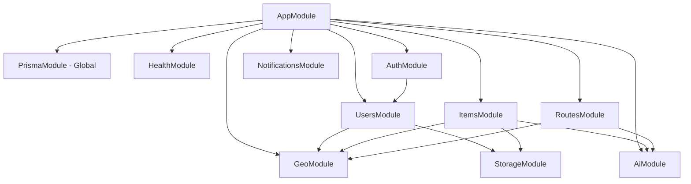
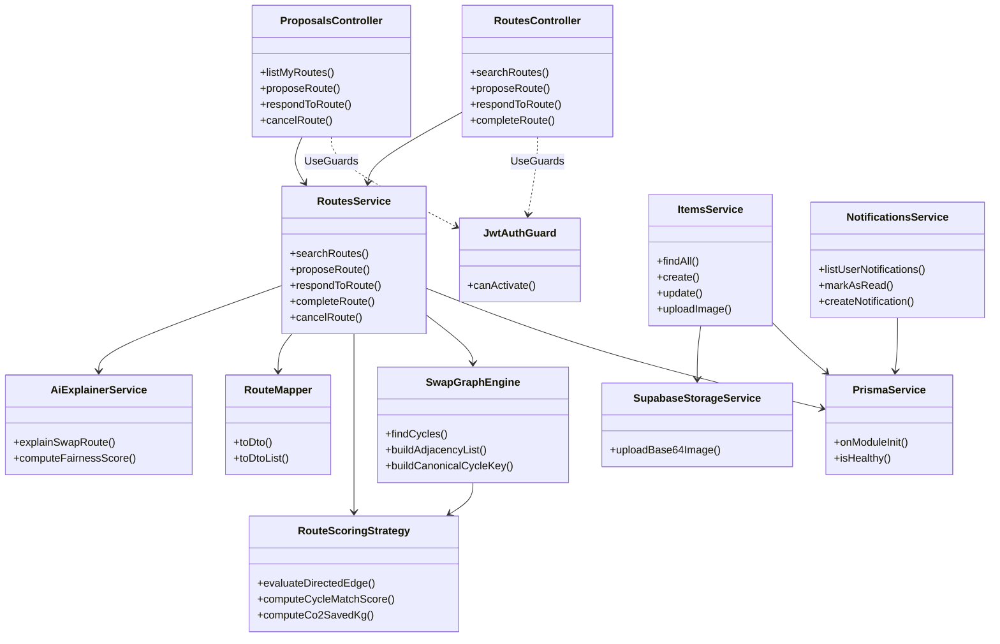

# 3. Vista lógica

El backend (`api/`, NestJS 10 + Prisma 5) sigue una regla de capas estricta, definida en `docs/graph/CODE_MAP.md` (§5): **`dto/` (validación Zod con `ZodValidationPipe`) → `controller` (protegido con `JwtAuthGuard`) → `service` (lógica de negocio y escrituras atómicas con `prisma.$transaction`) → `mapper` (entidad Prisma → DTO de respuesta)**. Los controladores solo traducen HTTP y delegan; los servicios nunca devuelven entidades crudas (p. ej. `RouteMapper.toDto`), y nunca se expone `passwordHash`. El acceso a datos se centraliza en `PrismaService`, provisto por un `PrismaModule` marcado `@Global()`, por lo que ningún módulo de negocio necesita importarlo explícitamente. El motor de rutas circulares (`SwapGraphEngine` + `RouteScoringStrategy`) es lógica pura sin I/O: el servicio carga el catálogo, el motor busca ciclos de 2, 3 y 4 saltos con DFS acotado y la estrategia puntúa aristas y ciclos.

## 3.1 Módulos Nest

Notas (confirmadas en `api/src/app.module.ts` y los `*.module.ts`):

- `AppModule` además registra `ConfigModule` (global), `ThrottlerModule` (120 req/min) y, como proveedores globales, `ThrottlerGuard` y `AllExceptionsFilter`.
- `AuthModule` importa `UsersModule` y registra `JwtModule` como global (secreto `JWT_SECRET`, expiración 7 días); por eso `JwtAuthGuard` puede inyectar `JwtService` en cualquier módulo.
- `StorageModule` (provee `SupabaseStorageService`) no lo importa `AppModule` directamente; llega a través de `ItemsModule` y `UsersModule`.
- `AiModule`, `GeoModule`, `NotificationsModule`, `HealthModule` y `PrismaModule` no importan otros módulos de negocio.
- `RoutesModule` **no** importa `NotificationsModule`: las notificaciones de propuestas se insertan dentro de la misma transacción (`tx.notification.createMany`).

## 3.2 Diagrama de clases (núcleo de rutas e ítems)

Leyenda: `-->` = dependencia inyectada por constructor; `..>` = uso declarativo (`@UseGuards(JwtAuthGuard)` a nivel de clase).

Dependencias reales omitidas para mantener el diagrama dibujable a mano (12 clases):

- `RoutesService` también inyecta `AiEmbeddingService` y `GeoService`.
- `ItemsService` también inyecta `AiEmbeddingService` y `GeoService`.
- `AiExplainerService` (y `AiEmbeddingService`, `AiVisionService`) inyectan `OpenAiClientService` (`chatJson`, `createEmbedding`, `isApiKeyConfigured`), que a su vez depende de `ConfigService`.
- `JwtAuthGuard` inyecta `JwtService`.
- `PrismaService` extiende `PrismaClient`; de ahí vienen `$transaction` y los delegados de modelo (`swapRoute`, `item`, `notification`…).

## 3.3 Responsabilidades

| Clase | Archivo | Responsabilidad |
|:---|:---|:---|
| `RoutesController` | `api/src/modules/routes/routes.controller.ts` | Endpoints `/routes/*`: búsqueda de ciclos (`/routes/search`, alias `/routes/find`), propuesta, respuesta, completar y cancelar rutas. |
| `ProposalsController` | `api/src/modules/routes/proposals.controller.ts` | Endpoints `/proposals/*`: misma lógica vista como "propuestas de trueque" (listar, crear, responder, completar, cancelar). |
| `JwtAuthGuard` | `api/src/common/guards/jwt-auth.guard.ts` | Valida el JWT del header `Authorization: Bearer` con `JwtService` y adjunta el usuario a la request. |
| `RoutesService` | `api/src/modules/routes/routes.service.ts` | Orquesta el caso de uso de trueque circular: carga catálogo, invoca el motor, persiste propuestas, bloquea ítems y aplica el consenso (aceptar/rechazar/completar/cancelar) dentro de `prisma.$transaction`, incluyendo notificaciones y métricas eco. |
| `SwapGraphEngine` | `api/src/modules/routes/engine/swap-graph.engine.ts` | Construye el grafo dirigido de ítems (lista de adyacencia) y busca ciclos de 2–4 saltos con DFS acotado, sin duplicados (clave canónica). |
| `RouteScoringStrategy` | `api/src/modules/routes/engine/route-scoring.strategy.ts` | Evalúa si una arista "A quiere lo de B" es válida (match léxico/semántico, tolerancia de valor) y calcula `matchScore` del ciclo y CO₂ ahorrado. |
| `RouteMapper` | `api/src/modules/routes/mappers/route.mapper.ts` | Convierte `SwapRoute` con relaciones Prisma a `SwapRouteDto` para la API. |
| `AiExplainerService` | `api/src/modules/ai/services/ai-explainer.service.ts` | Genera la explicación en español de una ruta vía OpenAI (con fallback determinista) y su índice de equidad. |
| `ItemsService` | `api/src/modules/items/items.service.ts` | CRUD de ítems, sincronización de "wants", filtros geográficos, embeddings y subida de imágenes. |
| `SupabaseStorageService` | `api/src/modules/storage/supabase-storage.service.ts` | Decodifica imágenes base64 y las sube a Supabase Storage, devolviendo la URL pública. |
| `NotificationsService` | `api/src/modules/notifications/notifications.service.ts` | Centro de notificaciones in-app: listar, contar no leídas, marcar como leídas, borrar y crear. |
| `PrismaService` | `api/src/prisma/prisma.service.ts` | Cliente Prisma único (global): conexión/desconexión en el ciclo de vida Nest y sonda de salud de la BD. |
