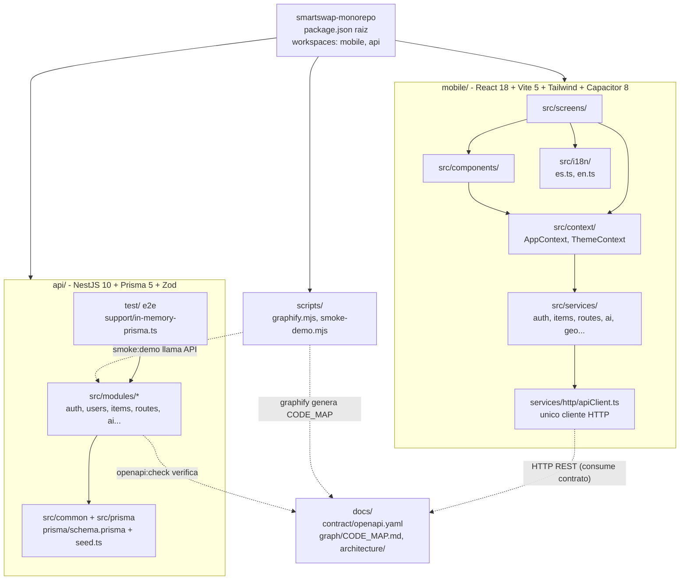

# 4. Vista de desarrollo

La vista de desarrollo muestra cómo está organizado el código fuente de SmartSwap. El repositorio es un monorepo con **npm workspaces**: el paquete raíz `smartswap-monorepo` declara dos workspaces (`mobile` y `api`) y concentra los scripts transversales (`graphify`, `smoke:demo`, `openapi:check`). El cliente móvil (`mobile/`) y el backend (`api/`) no comparten código: su único punto de acoplamiento es el contrato HTTP descrito en `docs/contract/openapi.yaml`, que el backend verifica con `openapi:check`. Dentro de `mobile/` las dependencias van en un solo sentido: pantallas → contexto → servicios → `apiClient`.

| Paquete | Tecnología | Comandos (`npm run ...`) |
|:---|:---|:---|
| `smartswap-monorepo` (raíz) | npm workspaces, Node.js | `dev:mobile`, `build:mobile`, `test:mobile`, `dev:api`, `build:api`, `test:api`, `test:e2e`, `openapi`, `openapi:check`, `typecheck`, `graphify`, `smoke:demo` |
| `mobile/` | React 18.3, Vite 5.4, Tailwind 3.4, Capacitor 8.6, react-router 6, i18next 23, Vitest | `dev`, `build`, `typecheck`, `lint`, `test`, `preview`, `format`, `android`, `build:apk` |
| `api/` | NestJS 10.4, Prisma 5.22, Zod 3.23, JWT, Swagger, Jest | `build`, `start`, `start:dev`, `start:debug`, `start:prod`, `typecheck`, `prisma:generate`, `db:seed`, `test`, `test:watch`, `test:cov`, `test:e2e`, `openapi`, `openapi:check`, `geo:generate`, `format` |
| `docs/` | Markdown, OpenAPI (YAML), JSON | Sin scripts propios: `openapi.yaml` lo regenera `npm run openapi`; `CODE_MAP.md` lo regenera `npm run graphify` |
| `scripts/` | Node.js (ESM) | Invocados desde la raíz: `npm run graphify`, `npm run smoke:demo` |

## Reglas de dependencia

- **Cero `fetch` directo**: componentes, pantallas y hooks nunca llaman `fetch()` ni Axios; todo pasa por los servicios de `services/` y, en última instancia, por `services/http/apiClient.ts`.
- **DTOs con Zod**: todo payload de entrada en `api/` se valida con esquemas Zod (`ZodValidationPipe`) ubicados en `src/modules/<modulo>/dto/`; flujo estricto `dto → controller → service → mapper`.
- **Atomicidad**: toda escritura que toca varias tablas usa `prisma.$transaction`.
- **Nunca exponer `passwordHash`**: ningún DTO, mapper ni respuesta de la API lo devuelve.
- **Sin secretos en el cliente**: las claves privadas (OpenAI, Supabase service role, etc.) viven solo en `api/`; nunca en `mobile/`.
