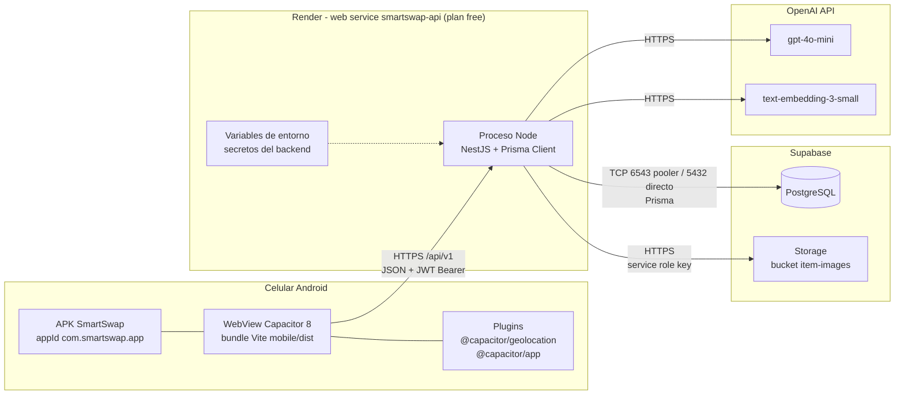

# 5. Vista de despliegue

La vista de despliegue muestra dónde se ejecuta físicamente cada pieza de SmartSwap. Hay cuatro nodos: el celular Android del usuario, que ejecuta la APK construida con Capacitor; el web service `smartswap-api` en Render, que corre el backend NestJS; el proyecto de Supabase, que aloja la base PostgreSQL y el almacenamiento de imágenes; y la API de OpenAI, que provee los modelos de visión/texto y de embeddings. La APK solo habla con Render. Render es el único nodo que conoce las credenciales y el único que habla con Supabase y OpenAI.

Nodos dibujados: 9 cajas dentro de 4 nodos físicos.

| Nodo | Artefacto | Configuración (archivo) |
|------|-----------|-------------------------|
| Celular Android | APK `SmartSwap` (`appId: com.smartswap.app`). Es un WebView de Capacitor 8 que carga el bundle de Vite (`webDir: dist`, generado con `tsc && vite build`). Usa los plugins `@capacitor/geolocation` y `@capacitor/app`. | `mobile/capacitor.config.ts`, `mobile/package.json` |
| Render (`smartswap-api`) | Proceso Node con NestJS (`runtime: node`, `rootDir: api`, `plan: free`). Build: `npm install --include=dev && npx prisma generate && npm run build`. Start: `npx prisma migrate deploy && npm run start:prod`. Health check: `/api/v1/health`. | `render.yaml` |
| Supabase: PostgreSQL | Base de datos relacional. La API usa `DATABASE_URL` (Transaction Pooler, puerto 6543, PgBouncer) y Prisma usa `DIRECT_URL` (puerto 5432) para `prisma migrate deploy`. | `api/prisma/schema.prisma`, `docs/deployment/SETUP_DIA1.md` |
| Supabase: Storage | Bucket público `item-images`. Guarda las fotos de objetos en `item-images/<userId>/...` y los avatares en `item-images/avatars/<userId>/...`. El backend sube los archivos con la service role key. | `api/src/modules/storage/supabase-storage.service.ts` (`BUCKET_NAME = 'item-images'`) |
| OpenAI API | `gpt-4o-mini` para el análisis de fotos y las respuestas en modo JSON, y `text-embedding-3-small` para los embeddings semánticos. | `api/src/modules/ai/services/openai-client.service.ts` |

## Variables de entorno

Todas se definen en el panel de Render (las marcadas con `sync: false` en `render.yaml` se cargan a mano y no quedan en el repositorio). Ninguna se empaqueta en la APK.

| Variable | Uso |
|----------|-----|
| `NODE_ENV` | Modo de ejecución (`production`). |
| `PORT` | Puerto HTTP del proceso Node. |
| `CORS_ORIGIN` | Orígenes permitidos para CORS. |
| `DATABASE_URL` | Conexión de Prisma a PostgreSQL a través del pooler (6543). |
| `DIRECT_URL` | Conexión directa (5432) para las migraciones. |
| `JWT_SECRET` | Firma y verificación de los tokens JWT. |
| `OPENAI_API_KEY` | Autenticación contra la API de OpenAI. |
| `SUPABASE_URL` | URL base del proyecto de Supabase (Storage). |
| `SUPABASE_SERVICE_ROLE_KEY` | Clave de servicio para escribir en Storage. Ignora RLS, así que nunca debe estar en `mobile/`. |

## Riesgo del plan free de Render

- **Arranque en frío:** el plan free duerme el servicio tras un rato sin tráfico. La primera petición despierta el contenedor y paga el arranque completo: levantar Node y ejecutar `prisma migrate deploy` antes de `start:prod`. Puede tardar decenas de segundos, y la app puede mostrar un timeout o un error de red en ese primer intento.
- **Calentamiento antes de la demo:** unos minutos antes de la presentación hay que llamar a `GET /api/v1/health` (navegador o `curl`) y esperar una respuesta 200. También se puede programar un monitor externo de keep-alive (por ejemplo UptimeRobot, como propone `docs/deployment/SETUP_DIA1.md`) que haga ping al health check cada pocos minutos durante la ventana de la demo.
- **Mitigación definitiva:** pasar a un plan pago de Render, que no duerme el servicio, si el sistema se usa fuera de la demo.
