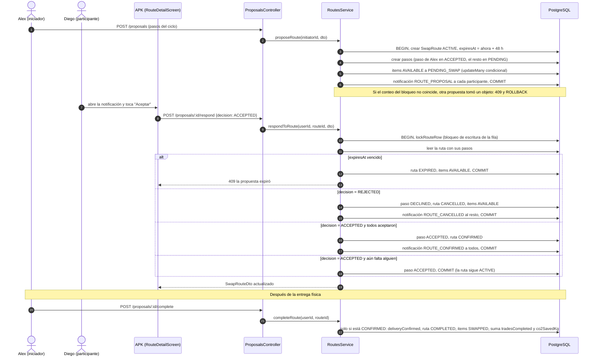
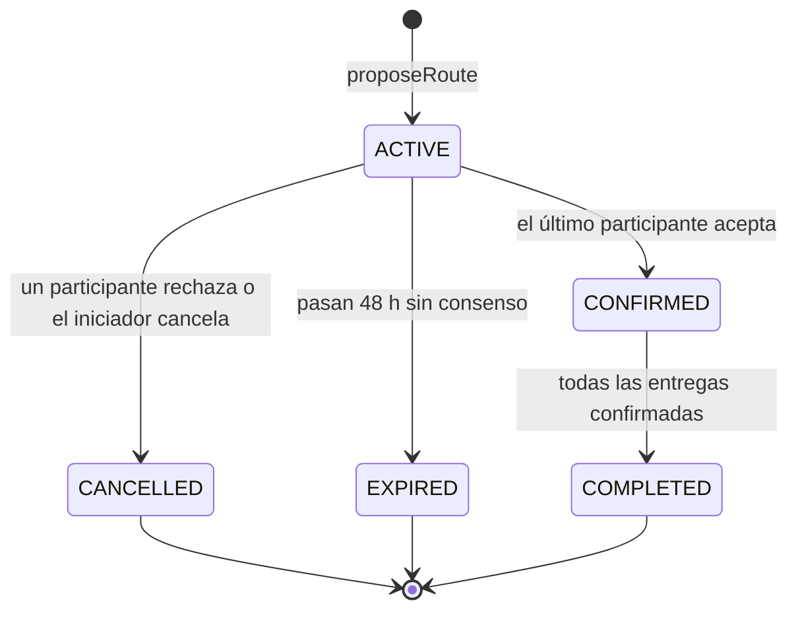

# 6. Secuencia: consenso de una propuesta

Una propuesta (`SwapRoute`) solo se confirma cuando **todas** las personas del anillo aceptan. Basta un rechazo para cancelarla. Cada respuesta corre dentro de un `prisma.$transaction` que primero bloquea la fila de la ruta (`lockRouteRow`). Así, si los dos últimos participantes aceptan al mismo tiempo, sus respuestas se procesan una tras otra y ninguno deja de ver la aceptación del otro.

Ejemplo con el seed: Alex propone el anillo **Mochila Totto → Zapatillas Nike → Parlante JBL**. Alex y Mateo ya aceptaron y falta Diego.

## Estados

| Estado de la ruta | Estado de los objetos | Quién lo provoca | Código |
|---|---|---|---|
| `ACTIVE` | `PENDING_SWAP` | `proposeRoute` | `api/src/modules/routes/routes.service.ts` |
| `CONFIRMED` | `PENDING_SWAP` | `respondToRoute`, cuando todos aceptaron | ídem |
| `CANCELLED` | `AVAILABLE` | `respondToRoute` con REJECTED, o `cancelRoute` | ídem |
| `EXPIRED` | `AVAILABLE` | `respondToRoute` o `expireOverdueRoutes` (se revisa de forma perezosa al listar, porque el plan free de Render no permite cron) | ídem |
| `COMPLETED` | `SWAPPED` | `completeRoute` | ídem |

**Cómo dibujarlo a mano:** seis líneas de vida (Alex, Diego, App, Controller, Service y BD) y un bloque `alt` con cuatro ramas. El estado de la ruta va anotado al lado de cada flecha que llega a la BD.
