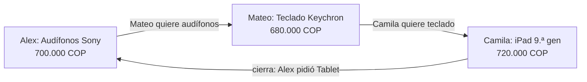

# 7. Algoritmo de ciclos de 2 a 4 personas

**Código:** `api/src/modules/routes/engine/swap-graph.engine.ts` (`SwapGraphEngine.findCycles`) y `route-scoring.strategy.ts` (`RouteScoringStrategy`). El motor es **puro**: corre en memoria y no consulta la base de datos. `RoutesService.searchRoutes` carga el catálogo de objetos `AVAILABLE` (filtrado por municipio o departamento) y se lo pasa al motor.

## Idea en una frase
Cada objeto es un nodo. Hay una arista **A → B** cuando el dueño de B quiere A, con valores en COP dentro de la tolerancia. Un trueque circular es un **ciclo simple dirigido** que sale del objeto ofrecido por quien busca y vuelve a esa persona con algo que coincide con lo que pidió.



## Reglas
| Regla | Dónde se aplica |
|---|---|
| Longitud k ∈ {2, 3, 4} (`MIN_CYCLE_STEPS`, `MAX_CYCLE_STEPS`) | `findCycles`, con `maxSteps` acotado por `clampInt` |
| Cada persona aparece una sola vez en el ciclo | `visitedUsers` en `dfsExploreCycles` |
| Solo entran objetos activos (se excluyen `PENDING_SWAP`, `SWAPPED` y `ARCHIVED`) | `isItemActive` |
| Arista A → B si un *want* del dueño de B coincide con A (tokens, categoría o similitud coseno ≥ 0,42 de los embeddings) y la diferencia de valor está dentro de la tolerancia (45 % por defecto, acotada entre 10 y 70) | `RouteScoringStrategy.evaluateDirectedEdge` |
| La arista de cierre usa el objetivo escrito por quien busca; si nada coincide, usa los *wants* del objeto ofrecido | `evaluateClosingEdges` |
| Sin duplicados: clave canónica `userId:itemId->…` anclada en el iniciador | `buildCanonicalCycleKey` |
| Se devuelven como máximo 10 ciclos (`MAX_RETURNED_CYCLES`), ordenados por puntaje | final de `findCycles` |

## Pseudocódigo
```text
findCycles(iniciador, objetivo, catálogo, maxPasos = 4, tolerancia = 45 %):
  activos  ← catálogo sin PENDING_SWAP / SWAPPED / ARCHIVED
  ofrecidos ← activos cuyo dueño es el iniciador
  ady ← buildAdjacencyList(activos)            # A→B si dueño(B) quiere A y el valor es parejo
  ciclos ← mapa vacío                            # claveCanónica → candidato
  para cada ofrecido en ofrecidos:
      cierre ← { X ajeno : X satisface el objetivo del iniciador }
      DFS(camino = [ofrecido], visitados = {iniciador})
  devolver top 10 de ciclos por (puntaje desc, saltos asc, …)

DFS(camino, visitados):
  actual ← último(camino);  k ← |camino|
  si 2 ≤ k ≤ maxPasos y actual ∈ cierre:
      guardar ciclo(camino) si su clave es nueva o tiene mejor puntaje
  si k = maxPasos: volver
  para cada arista actual→siguiente en ady[actual]:
      si dueño(siguiente) ∉ visitados:
          visitados += dueño(siguiente); camino += siguiente
          DFS(camino, visitados)
          deshacer (backtracking)
```

**Costo:** la lista de adyacencia es O(n²) sobre los n objetos activos del área. El DFS tiene profundidad máxima 4, así que explora a lo sumo O(d³) caminos por objeto ofrecido, donde d es el grado de salida. Con el catálogo de un municipio o departamento, eso son milisegundos.

## Puntaje (55 a 99)
```text
compuesto = 0,45·coincidencia_media + 0,35·paridad_de_valor_media + 0,10·compacidad + 0,10·reputación_media/5
compacidad = 1,0 (k=2) · 0,65 (k=3) · 0,30 (k=4)
puntaje = redondear(55 + compuesto·44)
CO₂ ahorrado = 2,4 kg × k
```
La compacidad premia los ciclos cortos: con más personas hay más riesgo de que alguien no responda.

## Ejemplo con las cuentas del seed (`api/src/seed/seed-data.ts`)
Alex (`alex@smartswap.co`, Pasto) busca con tres objetivos distintos. Cada objeto es querido por el dueño del siguiente, y el último cierra con el objetivo de Alex. El test `seed-data.spec.ts` (*"wires wants into a 2, a 3 and a 4 person cycle for Alex"*) lo verifica.

| k | Objetivo de Alex | Ciclo (quién entrega qué a quién) | Valores COP |
|---|---|---|---|
| 2 | "Guitarra" | Alex: Bicicleta Trek → Valeria · Valeria: Guitarra Yamaha → Alex | 900.000 / 850.000 |
| 3 | "Tablet" | Alex: Audífonos Sony → Mateo · Mateo: Teclado Keychron → Camila · Camila: iPad → Alex | 700.000 / 680.000 / 720.000 |
| 4 | "Consola Nintendo" | Alex: Reloj Garmin → Diego · Diego: Lente Sigma → Laura · Laura: Cámara Sony a6400 → Valeria · Valeria: Nintendo Switch → Alex | 1.100.000 / 1.000.000 / 1.050.000 / 1.000.000 |

**Traza del caso k = 3 (objetivo "Tablet"):**
1. `ofrecidos` = los cuatro objetos de Alex. La Mochila no entra porque está `PENDING_SWAP` en la propuesta en curso del seed.
2. Para Audífonos, `cierre` = {iPad}, porque el iPad coincide con "Tablet".
3. DFS: [Audífonos] → la arista Audífonos→Teclado existe porque Mateo quiere "Audífonos" y la diferencia de valor es de 2,9 %. Luego [Audífonos, Teclado] → la arista Teclado→iPad existe porque Camila quiere "Teclado". Con k = 3, el iPad está en `cierre` y el ciclo se guarda.
4. El DFS sigue buscando hasta k = 4 y luego hace backtracking. El ciclo queda con la clave `alex:audífonos->mateo:teclado->camila:ipad`. Aquí se muestran nombres; en el código la clave usa los UUID.

**Lo que el motor NO encuentra a propósito:** el anillo Mochila → Zapatillas → Parlante (Alex, Mateo y Diego), porque sus objetos ya están bloqueados en la propuesta del seed. Esa es la propuesta "en curso" que se muestra en la pestaña Trades.
