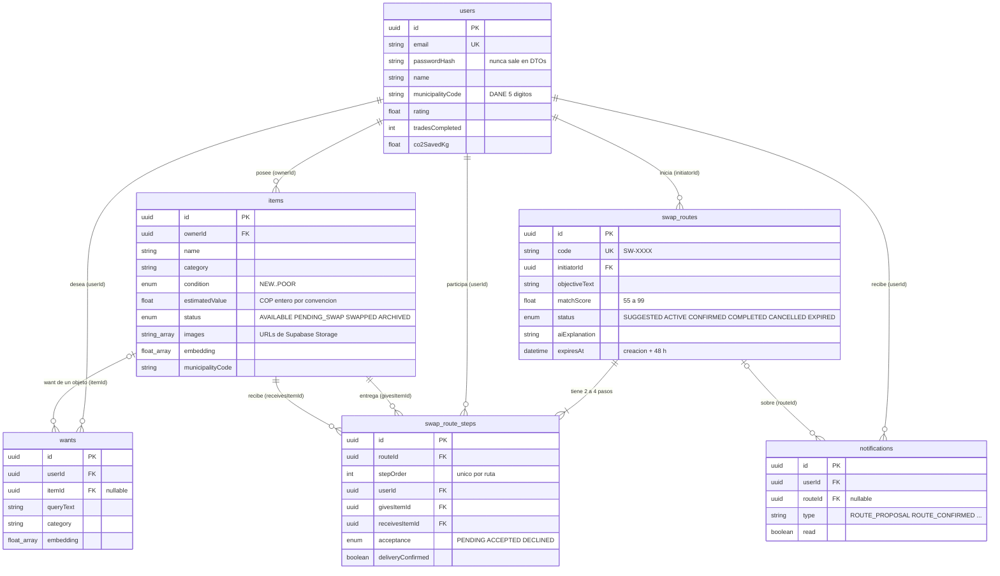

# 8. Modelo de datos (ER desde `schema.prisma`)

Generado a partir de `api/prisma/schema.prisma` (PostgreSQL en Supabase, migraciones en `api/prisma/migrations`). Solo se muestran las columnas que sirven para explicar el dominio; las marcas de tiempo `createdAt` y `updatedAt` se omiten.

## Notas de diseño
- **El ciclo se guarda como pasos ordenados.** `swap_route_steps` tiene `@@unique([routeId, stepOrder])`. El paso *i* entrega `givesItemId` al dueño del paso *i+1* y recibe `receivesItemId` del paso *i−1*.
- **Borrado protegido.** `givesItem` y `receivesItem` usan `onDelete: Restrict`: no se puede borrar un objeto que forma parte de una ruta. Usuarios, pasos y notificaciones usan `Cascade`.
- **Ubicación sin GPS.** Solo se guardan `departmentCode` y `municipalityCode` (DANE), nunca coordenadas.
- **Dinero.** `estimatedValue` es `Float` en la base de datos, pero el dominio lo trata como pesos enteros (ver [ADR-0002](adr/0002-cop-como-entero.md)).
- Índices: `items(ownerId)`, `items(municipalityCode)`, `items(departmentCode)`, `wants(userId)`, `wants(itemId)` y los FK de `swap_route_steps`.
